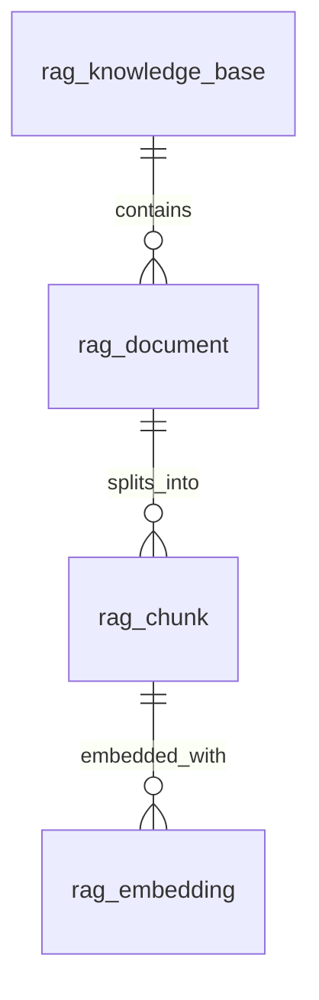

# RAG 資料庫設計

已選擇現有 MySQL 8.4 / `eth20`，不更換既有資料庫。DDL 為 `database/rag-schema.sql`（後端專案）；前端專案保留同名設計來源 `docs/rag-schema.sql`。

RAG 在詢問時先檢索可信文件，再把相關段落交給 LLM 回答；本次建立的是知識儲存基礎，沒有微調模型，也尚未把聊天室接上檢索功能。

## 關聯



| 資料表 | 用途與重要欄位 |
| --- | --- |
| `rag_knowledge_base` | 分隔不同知識範圍，例如操作手冊、FAQ、內部規範；`code`、`access_scope`、`enabled` |
| `rag_document` | 原始來源與抽取文字；`source_key`、`version`、`source_uri`、`content`、`content_sha256`、`status`、`chunker_version` |
| `rag_chunk` | 實際被檢索與引用的段落；`chunk_index`、`content`、`page_number`、`section_title`、`char_start/end` |
| `rag_embedding` | 段落向量；`provider`、`model_name`、`model_digest`、`preprocessing_version`、`dimensions`、`embedding` |

所有表使用 `utf8mb4`；時間欄位由資料庫記錄，應用程式統一以 UTC 寫入／讀取，畫面再轉台灣時間。主鍵使用 BIGINT；未來若回傳 JavaScript JSON，ID 請序列化為字串以避免精度流失。

## 匯入與更新規則

1. 建立知識庫，預設為 `PRIVATE`，不預先塞入正式知識內容。
2. 匯入 PDF、網頁、文字或資料庫抽取內容。`source_key` 是穩定短識別碼；長 URL 放 `source_uri`。先去掉密碼、私鑰、Cookie、個資等不應交給模型的資料。
3. 統一換行與文字格式，對 UTF-8 正規化後的完整文字計算 SHA-256。相同來源／內容可由應用程式跳過重複匯入；資料庫只強制「知識庫＋來源＋版本」唯一，以免誤合併不同來源的相同內容。
4. `PENDING → PROCESSING`，依段落切分並記錄 splitter 設定版本。可先採每段約 400～800 tokens、重疊約 50～100 tokens，再依實際文件調整；不能用字數當作 token 數。段落須符合 embedding 模型輸入上限。中文全文搜尋使用 ngram parser，實際效果須用你的資料驗證。
5. 使用支援 embedding 的 Ollama 模型產生段落向量。`qwen2.5-coder:7b` 目前負責聊天；不要假設聊天模型也適合產生檢索向量。此步驟尚未下載或指定 embedding 模型，維度不寫死。
6. 僅在所有段落與目標 embedding 空間的向量都完成時，於同一交易將文件設為 `READY`、寫入 `indexed_at`；失敗設為 `FAILED` 並記錄不含敏感資訊的錯誤。
7. 文件更新時新增版本，不直接修改已發布文字或段落。發布新版本時，應用程式須以交易鎖定知識庫列（`SELECT ... FOR UPDATE`），檢查該來源版本未衝突，將舊 `READY` 版本設為 `ARCHIVED`，再發布新版本。此跨列一致性不是 CHECK 約束自動保證的。

## 檢索流程

```text
問題 → 驗證使用者可讀的知識庫 → 問題向量
     → 篩選 enabled 知識庫與 READY 文件
     → 同模型 digest／provider／preprocessing_version／dimensions 的向量相似度
     → Top-K 段落＋來源 → 聊天 LLM → 附上文件、頁碼、段落引用
```

查詢向量與文件向量必須使用完全相同的 embedding 空間。固定模型 digest；只比較維度相同仍不夠。更換模型或前處理策略時新增另一組向量，完成重建後再切換檢索設定，不能混用不同空間排名。

初期可由 Java 讀取授權範圍內的候選 JSON 向量並計算 cosine similarity；全量掃描為 O(N×D)，只適用小型資料。JSON 儲存本身沒有向量近鄰索引。本設計保留段落 ID，未來可將向量索引移至專用向量服務，MySQL 繼續保存文件與引用來源；勿把 FULLTEXT 排名誤當向量相似度。全文搜尋可與向量檢索做混合排名，但只先以關鍵字過濾候選可能漏掉語意相關資料。

`PRIVATE/PUBLIC` 僅為分類，尚未建立授權 ACL。檢索服務必須先判斷使用者是否可讀，不能先把所有資料給 LLM 再要求模型隱藏。文件內容當作資料，不能當成系統指令；找不到足夠依據時應明確回覆無資料。

## 維護與驗證

DDL 僅新增 `rag_*` 表，沒有更動現有錢包／客戶資料表。刪除知識庫受到 RESTRICT 保護；明確刪除文件會連帶刪除其段落與向量。封存文件用 `ARCHIVED`，不必直接刪除。

向量約束驗證為數字陣列且長度等於 `dimensions`；文件／段落 hash 驗證為 64 位小寫十六進位。實際 hash 與文字一致性、有限浮點數、非零向量、chunk 對應原文、token 上限、完整發布及資料權限由未來匯入／檢索服務驗證。`IF NOT EXISTS` 不會修復既有同名表的不同結構，後續變更應另寫 ALTER migration。

參考：[MySQL JSON schema CHECK 驗證](https://dev.mysql.com/doc/refman/8.4/en/json-validation-functions.html)、[Ollama embedding API](https://github.com/ollama/ollama/blob/main/docs/api.md)。

## 本次執行結果

已在現有 MySQL 8.4.13 的 `eth20` 實際建立四張表。交易測試驗證中文文字與三維 JSON 向量可寫入及關聯查詢，刪除測試文件後段落與向量皆為零；最終回滾，四張表沒有測試資料。負向測試確認維度不一致及非數字向量觸發 MySQL 3819、重複段落序號觸發 1062，測試交易皆已回滾。未執行真實 embedding、語意搜尋或聊天室 RAG 整合，這些是後續應用程式功能。
